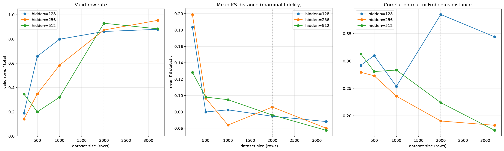

If you'd like to release a government dataset to researchers without compromising the individuals or places inside it, the standard toolkit is pretty unglamorous: generalize, add noise, or shuffle. Could an RNN be part of the answer?

A few years ago I noticed something intriguing while trying out a simple character-level RNN on a CSV: the model learns the format of the file so well that it produces rows that both parse and sit squarely within the data's statistics. So I set out to check how far that idea can go. This is the story of what happens when Karpathy's [2015 char-RNN](https://karpathy.github.io/2015/05/21/rnn-effectiveness/) is pointed at 3,211 US Census county records and asked to produce a synthetic copy of them: does it learn the schema, does it preserve the statistics, and does it beat the standard automatic anonymization techniques? Spoiler: it learns the schema impressively well, the marginal statistics well, and the joint structure only partially.

If you want to skip the setup and jump straight to the results, click [here](#results). If you want to skip the whole story and run the thing yourself, everything is open-source on GitHub: [https://github.com/akmiller01/char-rnn-synthetic-data-gen](https://github.com/akmiller01/char-rnn-synthetic-data-gen){:target="_blank"}

## Background

In 2015, Andrej Karpathy wrote a blog post titled [The Unreasonable Effectiveness of Recurrent Neural Networks](https://karpathy.github.io/2015/05/21/rnn-effectiveness/){:target="_blank"} in which he trains a character-level LSTM on text and lets it sample characters one at a time. The model doesn't see words, sentences, or structure — just characters. Yet it learns spelling, syntax, even the close-up syntactic constraints of markdown and LaTeX. He himself put it:

> If training vanilla neural nets is optimization over functions, training recurrent nets is optimization over programs.

The connection to data is immediate and, in my view, the most interesting part of the post: even if a dataset is not inherently sequential, it can be processed sequentially. A CSV is a perfectly good "text file" — a character sequence with the format of a particular tabular schema baked in. Feed a character-level LSTM that text, and it has every incentive to learn the column boundaries, the quoting, the quoting-that's-only-used-when-a-name-contains-a-comma, and the distribution of numbers. When you then sample it, it generates new rows.

## The issue

If a government agency wanted to release a microdataset to researchers, what would they need? A synthetic copy that others could analyze without being able to tell it apart from the real one — and that cannot be used to re-identify the people or places in the real data. Conventional automatic techniques for producing one cover a few neighborhoods:

- **k-anonymity**: generalize or suppress values so that each released record sits in a group of at least `k` records sharing the same generalization.
- **Noise addition**: perturb numeric values (Gaussian or Laplace noise) with a magnitude tied to a privacy budget.
- **Column shuffle / bag-of-rows**: break the link between identifiers and values — doing the minimum needed to disguise the data while preserving marginal statistics.

Each of these has a known weakness: generalization and noise destroy useful correlations; shuffle destroys *all* correlation; and none of them produces genuinely new records — they produce modified versions of real ones, with real names and real values in mind. That's the gap an RNN can fill.

## Building the char-RNN

The model is a direct port of Karpathy's recipe onto a modern PyTorch stack, running on a GPU. Architecture: an embedding layer (128-dimensional) feeding two separate single-layer `nn.LSTM` modules with hidden size 256, dropout 0.5 applied *between* the layers, a linear head, and cross-entropy loss on the next character. A couple of details worth mentioning.

The training loss is computed over random 200-character windows sampled from the dataset, with early stopping on a validation loss (patience 40) — a modern nod to the truncated backpropagation through time used in the original Torch code. Training runs take ~2 minutes for a ~950k-parameter model (hidden 256), and ~4-5 minutes for the largest model I tried (hidden 512, ~3.5M params).

Layman's version: the RNN is a character-level autoregressive model that reads the CSV as a single string, learns to predict the next character given the ones before it, and is then sampled repeatedly. Because the file format is regular, the "programs" it has to learn are mostly formatting and local statistics — the same way, in Karpathy's post, it learned line-endings, brackets and quotation marks in LaTeX and markdown.

One implementation note worth including: the naive way to apply dropout to the stacked LSTM — by setting `dropout=0.5` inside the `nn.LSTM` constructor — stalls training completely (gradients vanish and the loss never leaves 3.4). The fix is closer to Karpathy's original architecture: one LSTM module per layer, with an explicit `nn.Dropout` between them. Same parameters, same intent, very different outcome.

## Experimental setup

The data is 2023 American Community Survey 5-year estimates for all US counties, pulled through the Census Bureau API, after I dropped 12 rows with suppressed estimates (`-666666666` — small rural counties with insufficient sample sizes). Five of the columns are integers (population, poverty count, median household income, housing units, median gross rent) and two are floats (median household age, average household size), plus a geography name. 3,211 rows with 7 numeric columns. The geography names contain commas, so in the training text every row is written as a minimally-quoted CSV line, and every row is prefixed with a `BOS` control character — that's how the model knows "start of row" at generation time without learning a long-range dependency.

The model is trained to predict the next character in this character stream. Generation is done fresh-state-per-row: feed the model `BOS`, sample the next character, feed it back, stop at the next newline. Temperature sampling defaults to 1.0; I also check 0.5, 0.8, and 1.3. All sweep numbers come from the same recipe, with early stopping.

## Results

### Can an RNN produce statistically valid synthetic data? Yes.

Here are the generation stats at four temperatures. "Valid" means the row parses as CSV with the right number of columns and parseable numbers.

| Temperature | Valid rows | Mean KS | corr. Frob. | exact match | geo-names in synth |
| :---- | :---: | :---: | :---: | :---: | :---: |
| 0.5 | 100.0% | 0.247 | 0.110 | 0.000 | 0.076 |
| 0.8 | 98.6% | 0.115 | 0.203 | 0.000 | 0.037 |
| 1.0 | 92.8% | **0.048** | 0.190 | 0.000 | **0.021** |
| 1.3 | 70.2% | 0.140 | 0.439 | 0.000 | 0.001 |

(lower is better)

Full training takes ~143 seconds on a GPU. Examples from the output at t=1.0 are entirely plausible, and most names are invented (only 2.1% of synthetic geography names exist in the real data, and no synthetic row matches any real row). The strong correlations are preserved in quantity: the correlation between population and poverty is 0.89 in the synthetic set vs. 0.96 in the real one, the correlation between population and housing units is 0.76 vs. 0.99, and the mean of every column is close to the real value, though standard deviations are wider in the synthetic set — inflated by a handful of outlier rows (e.g. a synthetic median household income of 321k, against a real maximum of 178,707).

Two honest caveats. First, the weak correlations are flattened: the real age-size correlation is -0.50, and the synthetic set gets -0.02. Second, the means are slightly shifted upward (e.g. total population mean 111,740 vs. 104,523) and a handful of extreme rows inflate the standard deviations. In short: marginal distributions and most of the joint structure, learned end-to-end without a single tuning hand inserted.

And there's the temperature trade-off Karpathy himself showed: low temperatures (t=0.5) generate more valid rows but tighter, less diverse distributions; at t=1.3 the model emits unparseable rows roughly 30% of the time. Temperature 1.0 is the sweet spot — highest diversity such that ~93% of generated rows are valid.

### How does it compare to other automatic anonymization techniques?

I applied the same records through four classical techniques and evaluated them the same way. Note the baselines deliberately re-link the geography names across rows, so the comparison is fair — the RNN doesn't get the advantage of names not being known.

| Technique | valid | mean KS | corr. Frob. | max corr err | exact match | geo-names in synth |
| :---- | :---: | :---: | :---: | :---: | :---: | :---: |
| Real (reference) | — | 0.000 | 0.000 | 0.000 | 1.000 | 1.000 |
| Row permutation | 100% | 0.000 | 0.000 | 0.000 | **1.000** | 1.000 |
| Column shuffle | 100% | 0.000 | 0.433 | 1.004 | 0.000 | 1.000 |
| Gaussian noise (5%) | 100% | 0.060 | **0.001** | **0.003** | 0.000 | **1.000** |
| k-anonymity (~10 bins) | 100% | 0.051 | 0.091 | 0.175 | 0.000 | **1.000** |
| **RNN t=1.0** | 92.8% | **0.048** | 0.190 | 0.557 | **0.000** | **0.021** |
| **RNN t=0.8** | 98.6% | 0.115 | 0.203 | 0.597 | **0.000** | **0.037** |

(lower is better)

A few observations.

Row permutation is not anonymization at all — it preserves every record byte-for-byte (100% exact match). Column shuffle preserves every marginal exactly but destroys all joint structure (corr. Frob. 0.43). These are just "don't use" techniques.

Gaussian noise at 5% of std is the strongest fidelity performer: correlations preserved to nearly the fourth decimal place, marginal KS at 0.06, with the standard caveat that 5%-of-std is naive, not a true differential privacy budget. But it re-links the noise onto real records — every name is still there (100% reuse). k-anonymity via quantile binning is in a similar place on the mechanics (KS 0.051, corr. Frob. 0.091) but with one decisive flaw: at 7 numeric columns, the naive per-column generalization produces unique rows every time (effective k = 1), so no record hides in another record. It also keeps all the names.

The RNN is in a different league on the third attribute: it is the *only* technique tested that prevents re-identification by construction. Zero exact-match rows, ~2% of synthetic names present in the real data, 0% of synthetic rows identical to real ones. That's the whole point of a synthetic release — the record is gone, not just slightly distorted.

The RNN does not dominate the classical techniques on correlation fidelity: Gaussian noise wins that steadily (Frob. 0.001 vs. 0.19), as does k-anonymity (0.091). The honest reading is: Gaussian noise is the best choice if you *only* care about preserving the statistics of the released numbers, while the RNN is the best choice when you want genuinely new records rather than modified ones. A real release would likely want both — RNN for the shape of the data, noise for an achievable privacy guarantee (or a formal DP mechanism on the release, if you actually have one).

### Optimal dataset size to parameter count

With the model in hand, the remaining question is how to pick parameters for a given dataset. I swept dataset size (200, 500, 1000, 2000, 3211 rows) × hidden size (128, 256, 512, ~283k / ~950k / ~3.47M params) and recorded validity and fidelity:

The left panel is the one to stare at. Validity — the fraction of rows that parse — rises steadily with data size and model capacity. The middle panel is nearly flat beyond ~1000 rows: marginal distributions are learned early and then stay constant (KS 0.057-0.099). The right panel — correlation fidelity — only improves once enough data is available to support the model's parameter count; at 200-500 rows, a 283k-parameter model is already underfitted relative to what the data can support, and at 200 rows it is hopeless at any parameter count tried (14-35% valid).

A few useful rules from the numbers:

- Below ~1,000 rows, a large model (950k+ params) is too big and produces unparseable rows 35-65% of the time. A 283k model holds up 66-80% at 500-1000 rows.
- Enough data to learn the correlations requires **~2,000 rows for a ~1M-parameter model**: 2,000 rows with hidden 256 yields 87% valid, KS 0.086, corr. Frob. 0.190, and 3,211 rows with hidden 256 yields the best result in the sweep (95.4% valid, KS 0.060, corr. Frob. 0.183).
- Going past ~3,000 rows or ~1M parameters buys very little: hidden 512 at 3,211 rows gives 88% valid and ~the same KS, at 3.6x the parameter count and ~3x slower training.
- A 283k model at 3,211 rows (hidden 128) reaches 88% valid but with weak correlations (Frob. 0.344); a 950k model at 3,211 rows is clearly better.

In plain terms: the parameter budget should track the dataset size. For a dataset of a few thousand rows, ~1M parameters is the right scale; for ~500 rows, ~300k. Beyond a few thousand rows, scale the parameters roughly proportionally — though I only swept up to ~3,200 rows, so that part is a directional guess, not a measured fact.

## Synthesizing the character fields

The one thing none of the classical techniques can do is produce a new name. Gaussian noise leaves every name in place; k-anonymity leaves them in place too; they only perturb the numbers. The RNN, on the other hand, samples the name field character by character, and it is the only technique tested that can produce genuinely new names. For identity-like character fields — family names, for example — that is a feature, not a quirk. A synthetic name looks like a real one, invites no re-linking to the real world, and nothing about the analytic value of the release depends on records ever having existed: they are a plausible-looking approximation of the same process.

For geography, the calculus changes. In this experiment, invented county names are not what we want. A county-level release exists to attach figures to real places — Alabama, Texas, Nevada — and anyone consulting that dataset expects the records to correspond to places they can look up. A synthetic "Aranga Municipio" implies a fictional county, and a reader who cannot tell that apart from a real one loses the reason to trust the release at all. If the geography column is sensitive here, the right move is to keep the real identifier and synthesize only the rest of the row — the numbers — which is what Gaussian noise or k-anonymity give you, and almost no other technique does at this dimensionality.

The same per-field choice applies wherever a dataset mixes identifier fields and numeric fields: names and addresses — synthesize; geography, dates, and other reference fields — keep the real value and perturb the rest. The RNN gives all three options in one model, and that is a feature worth calling out, but the practical release is two techniques, not one, and the choice of which field is which belongs to the person releasing the data, not to the model.

## Conclusions

Andrej Karpathy's observation, nearly a decade later, still holds: a character-level LSTM trained on a few thousand rows of table data learns the column format, the quoting, the number formats, and marginal distributions — and produces rows that are valid, plausible, and statistically close to the real data, all without anyone hand-tuning the schema or the statistics. That's the core appeal of the method.

The honest caveats matter as much as the headline. The weakest correlations in the real data — the ones that actually carry most of the analytic value — are the ones the RNN struggles to preserve; the means are slightly shifted upward, and by a handful of extreme rows the spread in standard deviations is inflated; and at the small end of the data-to-parameter ratio it emits broken rows. The classical techniques are, respectively, better on correlation fidelity (Gaussian noise), better on preserving marginals (k-anonymity), and terrible on identity leakage (everything but the RNN).

For a genuinely synthetic release, the RNN is not a drop-in replacement for differential privacy — but it is a strong complement to it. The sensible recipe: let the RNN produce rows that carry the schema and the statistics, and combine it with a formal noise budget on the released numbers if the threat model demands one. That's the honest conclusion of this experiment.

If you'd like to replicate or just try it yourself: the code, data pipeline, evaluation, and sweep are all open-source at [https://github.com/akmiller01/char-rnn-synthetic-data-gen](https://github.com/akmiller01/char-rnn-synthetic-data-gen){:target="_blank"}. The full training, generation, and evaluation scripts use the same recipe as this post — ~2 minutes on a GPU, plus the sweep for the size-versus-parameter argument.
